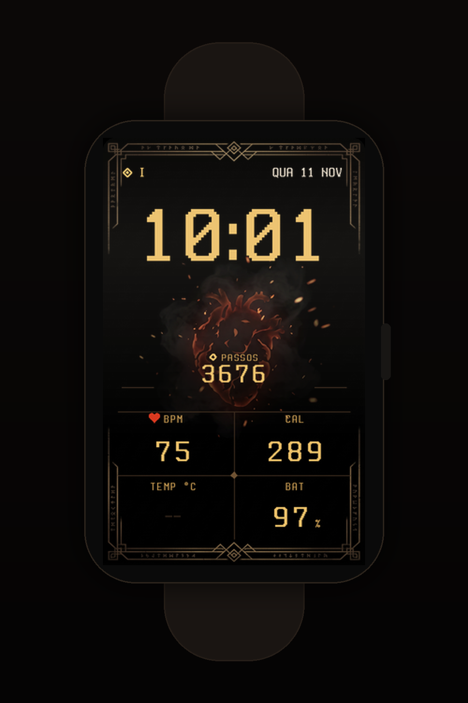

# ARISEN HUD · dd2-watchface

Face para **HUAWEI WATCH FIT Special Edition (STA-B39)** — HarmonyOS 2.1,
AMOLED **280 × 456**, identidade do rice Dragon's Dogma 2.



O projeto tem três camadas independentes:

1. **Arte** (`gen_assets.py`): fundo HUD, brasa, rótulos, atlas de dígitos, AOD,
   thumbnail. Tudo desenhado em Pillow com a fonte local.
2. **Layout** (`tools/layout.py`): edita o protobuf do `watchface.bin` — posição
   e alinhamento da hora, containers de widget (batimento, bateria, clima) e o
   elemento `DATE` (semana, dia e mês) com cópia para o AOD.
3. **Empacotamento** (`tools/hwformat.py`): escreve header, tabela e blobs de
   imagem no formato do firmware, com verificação antes de salvar.

Estado atual: **face instalada no relógio**, hora viva e **data dinâmica** no
topo (semana, dia e mês, normal e AOD). A v13 substitui a v9, que levava a data
assada no fundo. Batimento, passos, temperatura e bateria vêm dos widgets.

## estrutura

```
gen_assets.py             gerador de sprites (Pillow)
tools/hwformat.py         leitor/escritor do watchface.bin
tools/layout.py           editor do layout protobuf (schema v2)
tools/layout_info.py      resumo legível de elementos/layers/containers
tools/build_face.py       monta as variantes v0..v13 sobre o seed
tools/artbg.py            fundo a partir de fundo.jpg + rótulos (v4..v8)
tools/artbg_relic.py      fundo estático do Relic HUD, sem hora nem data (v9+)
tools/inspect_hwt.py      inventário de slots de um .hwt
tools/pack_hwt.py         troca sprites por slotmap
tools/sim_preview.py      simula o render do relógio
tools/mockup.py           põe o render no corpo do relógio
tools/dumppb.py           despeja a árvore protobuf do layout
tools/selftest.py         codec ida-e-volta (pacotes sintéticos)
tools/reencode_check.py   confere re-encode contra amostra real
docs/FORMAT.md            formato do pacote, bin e layout
```

Pastas ignoradas pelo git: `build/`, `out/`, `base/`, `fonts/` — artefatos,
seeds de terceiros e a fonte licenciada ficam fora do repositório.

## fonte

`gen_assets.py` procura `--font`, `DD2_FONT`, `fonts/*Terminess*` e as fontes do
sistema, nessa ordem. Sem Terminess ele cai em Cascadia Mono e avisa.

```powershell
copy <caminho>\TerminessNerdFontMono-Bold.ttf .\fonts\
python gen_assets.py --strict
```

`--strict` falha se o fundo cair abaixo de 80% de preto puro (medição atual:
86,5%). A hora é auto-ajustada para caber em 236 px.

## seed

O `watchface.bin` carrega a config (elementos, layers, value types). Em vez de
reescrever o schema inteiro, o projeto usa um pacote mínimo **HWHD06** gerado
pelo JoyoFit Studio (`base/myface.hwt`) como esqueleto: ele doa os elementos e
o `description.xml`, e o builder troca pele e geometria.

## build

```powershell
python gen_assets.py --strict     # sprites + preview
python tools/artbg.py             # fundo a partir da arte + rótulos (v4..v8)
python tools/artbg_relic.py       # fundo estático do Relic HUD (v9+)
python tools/build_face.py        # out/ARISEN_HUD_v0..v13.hwt
python tools/sim_preview.py out\ARISEN_HUD_v13.hwt --v9 --split-hour --split-minute `
    --time 14:23 --date 2026-11-17 --values "hr=62,cal=412,temp=24,bat=87,steps=3676"
python tools/mockup.py out\ARISEN_HUD_v13_sim.png out\preview_v13.png
```

A face para instalar é `out/ARISEN_HUD_v13.hwt`. O `--date` da simulação lê o
elemento `DATE` do próprio layout (refs e posições), então ele também serve de
teste do pacote.

Variantes:

| versão | o que muda |
|---|---|
| v0 | dígitos do tamanho do seed (50×53) |
| v1 | dígitos grandes (51×111) |
| v2 | v1 + hora/minuto ancorados à direita (`9` e `09` no mesmo pixel) |
| v3 | v2 + containers de batimento e bateria |
| v4 | v3 + arte do `fundo.jpg` como fundo e rótulos assentes nela |
| v5..v8 | banner de passos, grade 2×2 e hora em quatro controles |
| v9 | Relic HUD instalado; data assada no fundo (histórico, rebuild sai sem data) |
| v13 | v9 + elemento `DATE` dinâmico: semana, dia e mês, normal e AOD |

## instalar (iPhone → relógio)

1. Sideloadly no Windows + Apple ID grátis (7 dias por assinatura).
2. Sideload do `HuaSideload-1.1.ipa` (repo `Burak4Arslan/huawei-watch-sideload-ios`).
3. `Ajustes > Geral > VPN e Dispositivo > Desenvolvedor da Apple > Confiar` e
   `Ajustes > Privacidade e Segurança > Modo Desenvolvedor`.
4. No app: **Watch → Pair**, depois **Install → Watch faces → .hwt**.
5. Fechar o Huawei Health durante o pareamento — os dois brigam pelo BLE.

Firmware 2.x aceita face sem assinatura de servidor. O bloqueio por assinatura
RSA entrou no 6.0.0.328+.

## limites conhecidos

- **caloria**: o id não está resolvido (1 ou 3, ambos ambíguos na documentação).
- **data**: a ordem dos índices de semana/mês é inferida do export do Theme
  Studio (domingo = 1). Se o relógio mostrar deslocado, reordene os sprites.
- **temperatura** vem do clima sincronizado pelo celular; sem sync, `--`.
- A arte 1536×2752 é esticada ~9% no eixo vertical para 280×456; o frame é
  desenhado em 9:16 e o relógio é 0,614.
- Firmware 6.1+ exige assinatura da Huawei para face e para app — não se aplica
  ao 2.1, mas trava migração futura de relógio.
